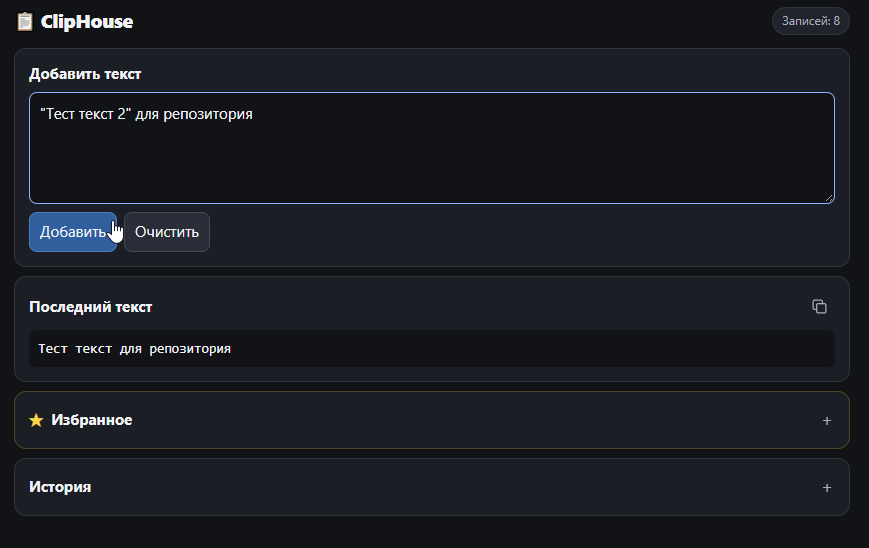
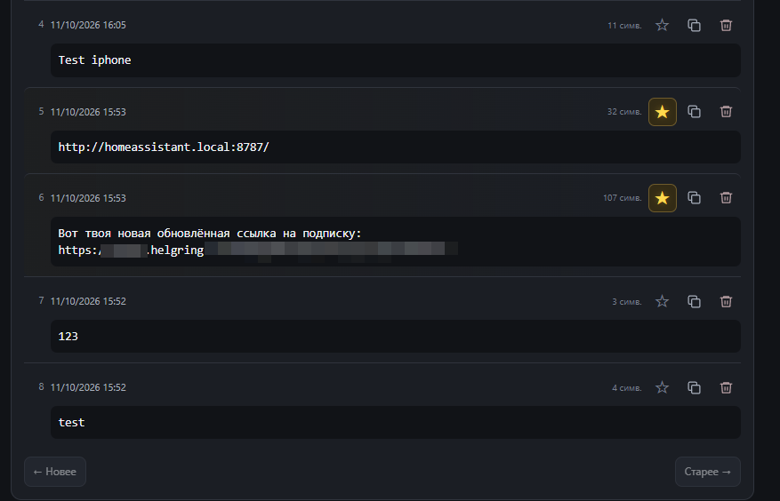

# 🏰 ClipHouse — личная крепость буфера обмена




## ⚔️ О проекте

**ClipHouse** — собственный локальный центр обмена текстом для компьютеров, смартфонов, планшетов и других устройств в домашней сети.

Никаких публичных онлайн-буферов, сомнительных сайтов и необходимости бегать между этажами с флешкой.

Скопировал текст на одном устройстве — открыл историю на другом — забрал нужное. Всё просто.

С блекджеком, шлюхами и SQLite.

### ✨ Возможности

- **Общий буфер обмена** — доступ к сохранённым текстам через браузер.
- **История копирований** — последние записи всегда под рукой.
- **SQLite** — локальная база данных вместо гигантских JSON-файлов.
- **Постраничная загрузка** — браузер не пытается проглотить весь архив целиком.
- **Поиск** — быстрое нахождение нужных записей.
- **Избранное** — жёлтая звёздочка для действительно важных текстов.
- **Удаление везде** — удалённая запись не должна воскреснуть на другом устройстве.
- **Home Assistant OS** — возможность держать сервер на устройстве, которое работает круглосуточно.
- **Веб-интерфейс** — ничего не нужно устанавливать на телефон или планшет.

## 🚀 Использование

Добавь адрес в закладки на компьютере, смартфоне, планшете и других устройствах домашней сети:

**[http://homeassistant.local:8787/](http://homeassistant.local:8787/)**

Открыл. Добавил. Скопировал. Закрыл.

Чтобы получить доступ, сервер Home Assistant должен быть включён, а устройство — подключено к домашней сети.

## 🛠️ Установка на Home Assistant OS

Установка не самая очевидная, зато после настройки ClipHouse можно оставить работать круглосуточно.

### 1. Подготовка

Убедись, что Home Assistant OS уже установлен и работает.

Установи приложение **Samba share**, если оно ещё не установлено. Оно позволит передавать файлы Home Assistant через обычный Проводник Windows.

### 2. Копирование приложения

Открой в Проводнике Windows сетевую папку:

`\\HOMEASSISTANT\local_apps\`

Если имя `HOMEASSISTANT` не разрешается, используй IP-адрес устройства, например:

`\\192.168.1.48\local_apps\`

Скопируй папку `cliphouse` из репозитория в `local_apps`.

В результате структура должна выглядеть так:

```text
local_apps
└── cliphouse
    ├── config.yaml
    ├── Dockerfile
    ├── run.sh
    └── ClipHouse.py
```

Не создавай дополнительную вложенную папку `cliphouse\cliphouse`.

### 3. Обнаружение приложения

Открой веб-интерфейс Home Assistant:

`http://homeassistant.local:8123/`

Перейди в **Настройки → Приложения → Магазин приложений**.


В меню с тремя точками нажми **«Проверить обновления»**.


ClipHouse должен появиться среди локальных приложений.


### 4. Установка и запуск

Открой ClipHouse в магазине приложений, нажми **«Установить»**, дождись окончания сборки и запусти приложение.

Для первоначальной сборки Home Assistant может понадобиться доступ к Docker Hub и GitHub Container Registry. Если соединение с реестрами блокируется, сборка может завершиться ошибкой.

После запуска открой:

`http://homeassistant.local:8787/`

Готово. Буфер обмена доступен из браузера.

### 5. Если установка не проходит


Проверь журнал приложения и Supervisor. Ошибки загрузки базового образа обычно связаны с доступом к реестрам контейнеров, а не с содержимым истории ClipHouse.

## 🗄️ Хранение данных

История хранится в локальной базе SQLite внутри постоянного хранилища приложения Home Assistant.

## 🔧 Обновление

1. Останови ClipHouse.
2. Замени исходные файлы приложения.
3. Увеличь версию в `config.yaml`.
4. Обнови локальные приложения в Home Assistant и установи новую версию.
5. Проверь журнал запуска supervisor и открой веб-интерфейс.

**Не удаляй базу SQLite при обновлении.** Именно в ней находится твоя история.

## 📦 Репозиторий

Исходный код, файлы проекта и дальнейшее развитие:

**[GitHub — ClipHouseProject](https://github.com/gitalexhubuser/ClipHouseProject)**

---

*ClipHouse — локальный общий буфер обмена через браузер.*
